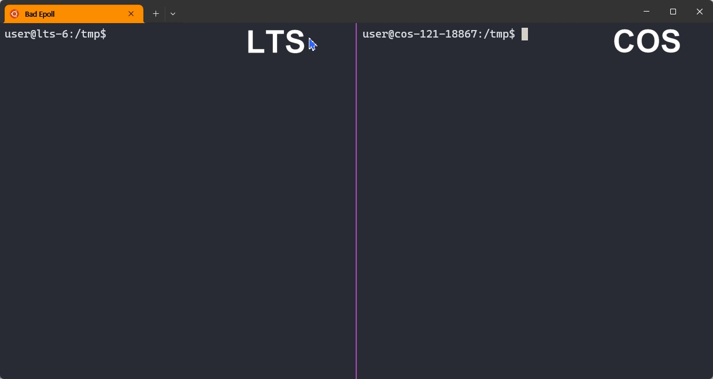
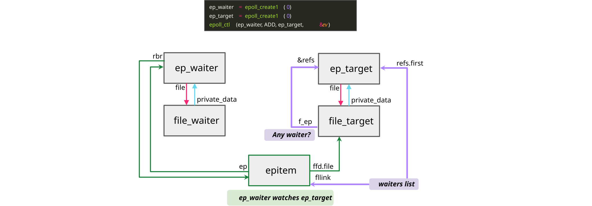
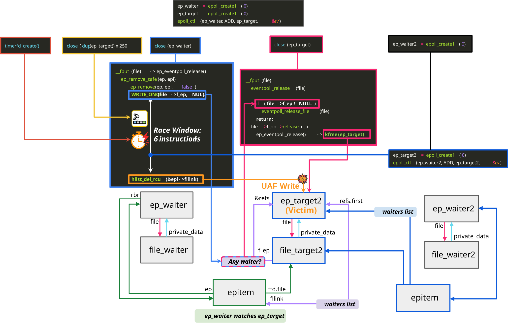
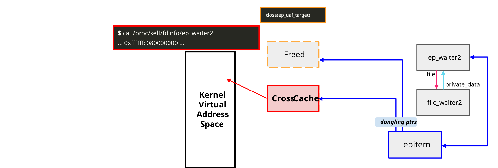

# Bad Epoll: The bug missed by Mythos

<em>An unprivileged process escalating to root on Google kernelCTF.</em>

Bad Epoll (CVE-2026-46242) is a race-condition use-after-free in the Linux kernel's
`epoll` subsystem. This bug lets an unprivileged process become root, not only on Linux desktops and servers but also on Android devices.

Bad Epoll was reported and exploited by [Jaeyoung Chung](https://j-jaeyoung.github.io/)
as a 0-day submission to Google [kernelCTF](https://google.github.io/security-research/kernelctf/rules.html), which rewards a Linux kernel exploit with $71,337+.

> [!NOTE]
> Anthropic's AI, [Mythos](https://red.anthropic.com/2026/mythos-preview/), found [another race bug](https://git.kernel.org/pub/scm/linux/kernel/git/stable/linux.git/commit/?id=07712db80857d5d09ae08f3df85a708ecfc3b61f) in the same epoll code but missed Bad Epoll.

---

## Why it is serious

1. **A rare bug that can root Android.**
Most Linux privilege-escalation bugs cannot root Android at all. [Copy Fail](https://copy.fail/) and its
variants, for example, need modules that Android never loads. Out of the roughly 130 vulnerabilities exploited on Google's kernelCTF, only
about ten are candidates for rooting Android. Bad Epoll is one of them.

    * Bad Epoll can also be triggered from inside Chrome's renderer sandbox, which blocks
almost every other kernel bug. A renderer exploit could therefore chain with Bad Epoll to
achieve kernel code execution, the same impact Project Zero demonstrated in
["From Chrome renderer code exec to kernel with MSG_OOB"](https://projectzero.google/2025/08/from-chrome-renderer-code-exec-to-kernel.html).

2. **No kill-switch.**
Copy Fail and its variants can be neutralized by unloading their vulnerable modules,
but epoll has no such option. It is a core kernel feature that the operating system,
network services, and browsers all rely on. The only way to fix it is to apply the patch.

3. **Tiny race window, but the attack is 99% reliable.** 
The bug's race window is only about six instructions wide, and a normal attempt almost never hits it. The exploit widens that window and runs a retry loop that never crashes the kernel. The result is a 99% reliable exploit, as the [attack overview](#how-the-attack-works) below describes.

---

## The bug Mythos missed

A single [commit](https://git.kernel.org/pub/scm/linux/kernel/git/torvalds/linux.git/commit/?id=58c9b016e128) in 2023 introduced two separate race conditions into the epoll code, only about 2,500 lines in all. Both turned out to be critical bugs that can lead to privilege escalation.

The first was found by Anthropic's [Mythos](https://red.anthropic.com/2026/mythos-preview/)
and reported as [CVE-2026-43074](https://git.kernel.org/pub/scm/linux/kernel/git/stable/linux.git/commit/?id=07712db80857d5d09ae08f3df85a708ecfc3b61f).
That result is impressive on its own, because kernel race bugs are known to be hard to find. It showed a frontier AI model's ability to find race bugs. An independent researcher later [submitted a 1-day exploit](https://github.com/2045castor/security-research/blob/submit_final/pocs/linux/kernelctf/CVE-2026-43074_lts/docs/exploit.md) for it to kernelCTF.

The other race is Bad Epoll, which Mythos missed. Given that Mythos found the first bug
in this small epoll code path, it likely examined the same area with meaningful depth.
We cannot know exactly why it missed Bad Epoll, but two factors likely made it hard to find. 

- **The race window is tiny.** It is only about six instructions
  wide, so the exact thread interleaving is hard to imagine even when looking at the
  vulnerable code.

- **There was little runtime evidence.** After CVE-2026-43074 is fixed, Bad Epoll's
  use-after-free usually does not trigger KASAN, the kernel's main memory-error
  detector. Without that signal, Mythos may not have had enough confidence to report it
  as a real bug.

Bad Epoll was hard to fix, too. The maintainers' first patch did not fully fix the issue, and a correct patch landed only two months after the bug was first reported. That is a long time for a kernel that usually handles security issues with urgency.

Overall, Bad Epoll shows how difficult race conditions are at every stage. They are hard
to find even for a frontier model, hard to fix correctly, and, as the next section shows,
hard to exploit reliably. It also suggests a vulnerability research direction that
remains worth exploring in the presence of frontier AI models: uncovering real security
impact behind narrow timing conditions and weak evidence.

---

## How the attack works

Here is a high-level overview of the attack, for the curious.

<em>Two linked epoll objects. Closing both at once triggers the race.</em>

Two of epoll's close paths run at the same time and collide. One frees an object
while the other is still writing into it, and that is the use-after-free (UAF).

<em>The race window, and how the exploit drives it.</em>

The exploit uses four epoll objects grouped into two pairs. One pair triggers the race, while the other becomes the victim. From there, the exploit turns the 8-byte UAF write into a UAF on a file object, and uses a cross-cache attack to fully control the file's contents.

<em>Turning the bug into an arbitrary kernel memory read through /proc/self/fdinfo.</em>

With that control, the exploit gains an arbitrary read of kernel memory through `/proc/self/fdinfo`. Finally, it
hijacks control flow and executes a ROP chain to gain a root shell.

More details are available in the full exploit [writeup](https://github.com/J-jaeyoung/security-research/blob/submit-cve-2026-46242/pocs/linux/kernelctf/CVE-2026-46242_lts_cos/docs/exploit.md) and [code](https://github.com/J-jaeyoung/security-research/blob/submit-cve-2026-46242/pocs/linux/kernelctf/CVE-2026-46242_lts_cos/exploit/lts-6.12.67/exploit.cpp).

---

## Mitigation

Because epoll cannot be disabled, Bad Epoll has no simple workaround. The only remedy is to apply the patch.

- Apply upstream commit
  [`a6dc643c6931`](https://git.kernel.org/pub/scm/linux/kernel/git/torvalds/linux.git/commit/?id=a6dc643c69311677c574a0f17a3f4d66a5f3744b),
  or your distribution's backport once it becomes available.

## Affected versions

Bad Epoll was introduced by
[`58c9b016e128` (2023-04-08)](https://git.kernel.org/pub/scm/linux/kernel/git/torvalds/linux.git/commit/?id=58c9b016e12855286370dfb704c08498edbc857a)
and fixed by
[`a6dc643c6931` (2026-04-24)](https://git.kernel.org/pub/scm/linux/kernel/git/torvalds/linux.git/commit/?id=a6dc643c69311677c574a0f17a3f4d66a5f3744b).

Many Linux distributions may be affected if they use kernels based on v6.4 or newer and
have not yet backported the fix. Check your distribution's kernel security updates for a
backport of the fix commit above. Older v6.1-based kernels are not affected because the
bug was introduced in v6.4.

The current exploit is written for the following Google kernelCTF targets.

- `lts-6.12.67` (LTS), 99% reliable
- `cos-121-18867.294.100` (COS), 98% reliable

The Android exploit is still in progress.

- Pixel 10 (kernel v6.6+): the current PoC triggers the UAF and a full root
  exploit is in progress. We will release the Android exploit and writeup once they are
  complete.
- Pixel 8 and other v6.1-based devices: not affected, since the bug was introduced in v6.4.

## Timeline

| Date | Event |
|---|---|
| 2023-04-08 | The bug was introduced into epoll (commit `58c9b016e128`). |
| 2026-02-17 | We reported the bug to security@kernel.org. |
| 2026-02-17 | Maintainers proposed a patch prototype, but it was not a correct fix and the discussion then stalled. |
| 2026-04-02 | The fix for the bug Mythos found (CVE-2026-43074) landed in mainline. |
| 2026-04-22 | We re-reported the remaining issue. |
| 2026-04-24 | The fix for this bug landed in mainline (commit `a6dc643c6931`). |

---

## FAQ

### Why is it called "Bad Epoll"?

The name follows the "Bad" series of Android-rooting kernel bugs,
whose earlier entries include [Bad Binder](https://projectzero.google/2019/11/bad-binder-android-in-wild-exploit.html), 
[Bad IO_uring](https://github.com/Markakd/bad_io_uring), and [Bad Spin](https://github.com/0xkol/badspin). Bad Epoll is the epoll counterpart.

### Where can I find the technical details?

This page is the short version. You can find the full root-cause analysis, exploit writeup, and exploit code in the following links.

- [Root-cause writeup](https://github.com/J-jaeyoung/security-research/blob/submit-cve-2026-46242/pocs/linux/kernelctf/CVE-2026-46242_lts_cos/docs/vulnerability.md)
- [Exploit writeup](https://github.com/J-jaeyoung/security-research/blob/submit-cve-2026-46242/pocs/linux/kernelctf/CVE-2026-46242_lts_cos/docs/exploit.md)
- [Exploit code](https://github.com/J-jaeyoung/security-research/blob/submit-cve-2026-46242/pocs/linux/kernelctf/CVE-2026-46242_lts_cos/exploit/lts-6.12.67/exploit.cpp)

---

## Credits

Bad Epoll was reported and exploited by [Jaeyoung Chung](https://j-jaeyoung.github.io/).

Huge thanks to our research group, [CompSec Lab](https://compsec.snu.ac.kr), and
especially to [Eulgyu Kim](https://eulgyukim.github.io/), [Woohyuk Choi](https://cw00h.github.io/), [Dae R. Jeong](https://daeryong.me/) and my advisor [Byoungyoung Lee](https://lifeasageek.github.io/),
for their guidance and support.
